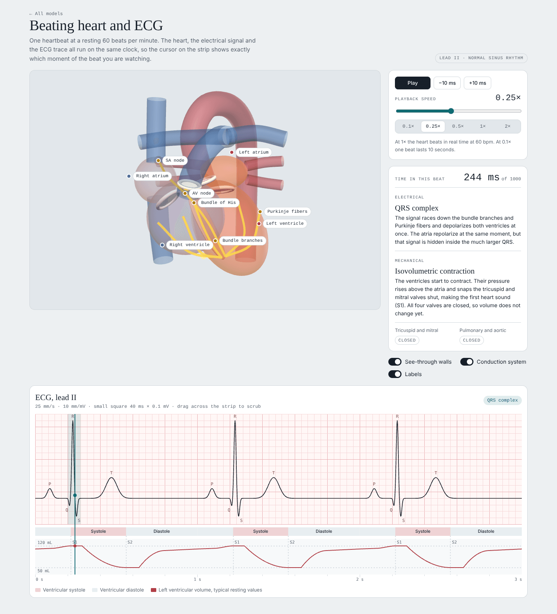
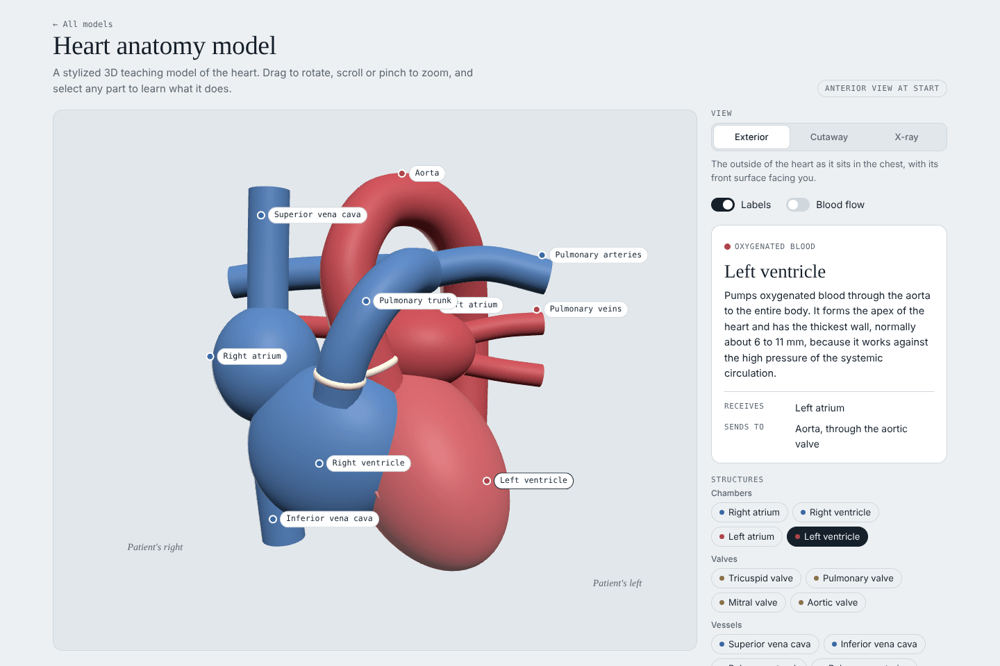

# Heart Models

Interactive 3D teaching models of the human heart, built with Three.js, TypeScript and Vite.

- **Heart anatomy model:** explore the chambers, valves and great vessels in exterior, cutaway and X-ray views, with animated blood flow.
- **Beating heart and ECG:** one heartbeat in adjustable slow motion, where the 3D heart, its conduction system and a lead II ECG strip all run on a single clock.

**Live demo:** https://aschoi.github.io/heart-models/



## Features

### Beating heart and ECG

- A sweeping cursor on the ECG strip marks the current moment, and the strip highlights the active segment (P wave, PR segment, QRS complex, ST segment, T wave).
- The conduction impulse travels SA node → AV node (with the AV delay) → bundle of His → bundle branches → Purkinje fibers.
- Chamber walls glow as they depolarize and fade as they repolarize. The atria and ventricles contract and fill in the correct order, and the valves open and close.
- A live readout explains the current electrical event and mechanical phase, with the state of both valve pairs.
- A systole/diastole band and a left ventricular volume curve sit under the ECG, with S1 and S2 marked.
- Playback runs from 0.05× to 2× with presets, play/pause and 10 ms steps. You can drag across the strip to scrub.
- The ECG paper is drawn at standard scale: 25 mm/s and 10 mm/mV, with one small square equal to 40 ms × 0.1 mV.

### Heart anatomy model



- Exterior, cutaway (a clipping plane) and X-ray (see-through walls) views.
- Every structure can be selected from the model, its label or the side panel, and each has a short description.
- Labels track the model as it rotates and dim when another structure hides them.
- Animated blood flow through the right heart to the lungs and the left heart to the aorta.
- Orientation markers for the patient's right and left.

Both pages support light and dark themes, touch input and phone-width layouts.

## Architecture

```
src/
  shared/
    heart.ts       Heart geometry: chambers, vessels, valves, in the patient's coordinate frame
    viewer.ts      Renderer, camera, lights, orbit controls and resizing
    labels.ts      HTML labels projected from 3D points every frame
    theme.css      Design tokens (light and dark) and shared components
  anatomy/
    main.ts        View modes, picking, label occlusion and the side panel
    parts.ts       Descriptions and facts for each structure
    flow.ts        Blood-flow particles (one InstancedMesh per route)
  heartbeat/
    cycle.ts       The cardiac cycle as pure functions of time (no Three.js, no DOM)
    conduction.ts  Conduction system pathways and the travelling impulse
    ecgStrip.ts    Canvas 2D ECG strip, systole band and volume curve
    main.ts        Playback state, readout and the main loop
tests/
  cycle.test.ts    Physiology and timing checks for cycle.ts
```

### One clock, pure functions

The heartbeat model is built so the visuals cannot drift out of sync. `cycle.ts` describes one 1000 ms cycle at 60 bpm as pure functions of time:

| Function                                          | Drives                                   |
| ------------------------------------------------- | ---------------------------------------- |
| `ecgMillivolts(t)`                                | ECG trace (one Gaussian per P/Q/R/S/T)   |
| `lvVolumeMl(t)`, `ventricularScale(t)`            | Volume curve and ventricular size        |
| `atrialScale(t)`                                  | Atrial size                              |
| `avValveOpenness(t)`, `semilunarValveOpenness(t)` | Valve discs and the valve readout        |
| `atrialActivation(t)`, `ventricularActivation(t)` | Depolarization glow                      |
| `pulseLevel(t, start, end)`                       | Conduction pathway brightness            |
| `segmentAt(ELECTRICAL \| MECHANICAL, t)`          | Readout text and the highlighted segment |

The main loop advances a single `simTime` by real elapsed time multiplied by the playback speed, then hands `simTime mod 1000` to every renderer. Scrubbing and stepping only change `simTime`.

Because `cycle.ts` has no dependencies, its physiology is unit-tested directly. The tests check that the timeline segments tile the cycle, that the R wave peaks inside the QRS complex, that the PR, QRS and QT intervals fall within normal adult ranges, that the AV and semilunar valves are never open at the same time, that volume stays constant during the isovolumetric phases, and that the ejection fraction is normal.

### Rendering notes

- The ECG grid, trace and volume curve are drawn once to an offscreen canvas. Each frame copies that layer and adds only the cursor, so the strip costs almost nothing per frame.
- The conduction system is rendered with `depthTest: false` so it stays visible through the heart walls.
- Label occlusion uses raycasts from the camera, recomputed only after the view changes rather than every frame.

## Getting started

Requires Node.js 22.12 or newer (`.nvmrc` pins 24).

```bash
npm install
npm run dev
```

Then open the URL Vite prints (usually http://localhost:5173).

| Script            | What it does                                              |
| ----------------- | --------------------------------------------------------- |
| `npm run dev`     | Start the dev server with hot reload                      |
| `npm run build`   | Typecheck, then build to `dist/`                          |
| `npm run preview` | Serve the production build locally                        |
| `npm test`        | Run the unit tests once                                   |
| `npm run lint`    | Lint with ESLint and typescript-eslint                    |
| `npm run format`  | Format with Prettier                                      |
| `npm run check`   | Format check, lint, typecheck, test and build, as CI does |

## Deployment

`.github/workflows/deploy.yml` builds the site and publishes it to GitHub Pages on every push to `main`. To turn it on, open the repository's **Settings → Pages** and set **Source** to **GitHub Actions**. The site uses a relative base path, so it works under any repository name.

`.github/workflows/ci.yml` runs the same checks as `npm run check` on every push and pull request. Dependabot keeps npm packages and GitHub Actions up to date.

## Accuracy

These are stylized teaching models. Chamber and vessel positions are anatomically arranged, but shapes are built from simple primitives, and the coronary arteries are not modeled. The ECG is a synthesized, idealized lead II trace, and all timings and volumes are representative textbook values for a healthy adult at rest, not patient data.

## License

[MIT](LICENSE)
